# Architecture

Generated by `backend/src/scripts/architecture-diagram.ts` from the code:
the route registrations, the imports of `backend/src/services/`, and the
packages that reach outside systems. **Do not edit by hand**: run
`npm run docs:architecture` in `backend` after a change. CI runs it with
`--check` and fails when this file no longer matches the code.

246 routes in 16 files; 45 services in use.
Solid arrows are imports; dotted arrows reach a system outside the code.

```mermaid
flowchart LR
  subgraph client["my-pwa, the React PWA"]
    landing["index.html, the landing page<br/>pre-rendered at build, src/landing"]
    doors["The doors<br/>/student/sign-in, /supervisor/sign-in, /coordinator/sign-in"]
    pwa["Student, supervisor and coordinator portals<br/>app.html, offline queue, service worker"]
    apps["Installable apps<br/>INTERNet Coordinator, INTERNet Trainee, INTERNet Supervisor, INTERNet: OJT Monitoring & Analytics"]
  end
  landing --> doors
  doors --> pwa
  apps --> doors
  subgraph api["backend, the Express API"]
    server["server.ts<br/>94 routes: /api/coordinator, /api/attendance, /api/notifications"]
    routes_academics["routes/academics.ts<br/>11 routes: /api/coordinator"]
    routes_accountDetails["routes/accountDetails.ts<br/>7 routes: /api/coordinator, /api/me"]
    routes_appeals["routes/appeals.ts<br/>4 routes: /api/appeals, /api/coordinator"]
    routes_attachments["routes/attachments.ts<br/>5 routes: /api/attachments"]
    routes_console["routes/console.ts<br/>8 routes: /api/coordinator"]
    routes_deliverables["routes/deliverables.ts<br/>2 routes: /api/coordinator, /api/students"]
    routes_extensions["routes/extensions.ts<br/>71 routes: /api/coordinator, /api/absences, /api/students"]
    routes_institution["routes/institution.ts<br/>2 routes: /api/coordinator"]
    routes_messages["routes/messages.ts<br/>4 routes: /api/messages"]
    routes_offlineTimeIn["routes/offlineTimeIn.ts<br/>4 routes: /api/attendance, /api/offline"]
    routes_passkeys["routes/passkeys.ts<br/>5 routes: /api/passkeys"]
    routes_programme["routes/programme.ts<br/>10 routes: /api/coordinator"]
    routes_projections["routes/projections.ts<br/>1 routes: /api/students"]
    routes_supervisorDesk["routes/supervisorDesk.ts<br/>13 routes: /api/supervisor, /api/tasks, /api/student-notes"]
    routes_timeRecord["routes/timeRecord.ts<br/>5 routes: /api/student, /api/students, /api/time-record"]
  end
  subgraph services["backend/src/services"]
    services_academics["academics.ts"]
    services_analyticsRange["analyticsRange.ts"]
    services_audit["audit.ts"]
    services_backups["backups.ts"]
    services_clientErrors["clientErrors.ts"]
    services_coordinatorActions["coordinatorActions.ts"]
    services_dayRules["dayRules.ts"]
    services_deadlineReminders["deadlineReminders.ts"]
    services_deliverables["deliverables.ts"]
    services_digests["digests.ts"]
    services_documentZip["documentZip.ts"]
    services_emailBudget["emailBudget.ts"]
    services_ids["ids.ts"]
    services_imageMetadata["imageMetadata.ts"]
    services_insights["insights.ts"]
    services_kpiDefinitions["kpiDefinitions.ts"]
    services_kpis["kpis.ts"]
    services_listQuery["listQuery.ts"]
    services_liveNotifications["liveNotifications.ts"]
    services_liveness["liveness.ts"]
    services_loopLock["loopLock.ts"]
    services_mailer["mailer.ts"]
    services_notificationKinds["notificationKinds.ts"]
    services_notificationLinks["notificationLinks.ts"]
    services_notificationPreferences["notificationPreferences.ts"]
    services_offlineActions["offlineActions.ts"]
    services_offlineAttestation["offlineAttestation.ts"]
    services_passkeys["passkeys.ts"]
    services_performance["performance.ts"]
    services_phTime["phTime.ts"]
    services_photoPurge["photoPurge.ts"]
    services_photoRedo["photoRedo.ts"]
    services_privacy["privacy.ts"]
    services_privateFileStore["privateFileStore.ts"]
    services_problems["problems.ts"]
    services_projection["projection.ts"]
    services_removedRecords["removedRecords.ts"]
    services_schedulePattern["schedulePattern.ts"]
    services_schedules["schedules.ts"]
    services_studentScope["studentScope.ts"]
    services_taskRelease["taskRelease.ts"]
    services_termSetup["termSetup.ts"]
    services_timeOutReminders["timeOutReminders.ts"]
    services_uploadQuota["uploadQuota.ts"]
    services_versions["versions.ts"]
  end
  subgraph cron["Railway cron service, nightly"]
    scripts_backup_cron["scripts/backup-cron.ts<br/>pg_dump, encrypted, to the backup bucket"]
  end
  subgraph outside["Outside systems"]
    ext_postgres["PostgreSQL"]
    ext_smtp["Mail server SMTP"]
    ext_email_api["Email provider API"]
    ext_push["Browser push services"]
    ext_bucket["Object storage R2 or S3"]
    ext_azure["Azure Blob Storage"]
    ext_webauthn["The phone's screen lock, WebAuthn passkeys"]
  end
  pwa -->|"HTTPS JSON and the /api/events stream"| api
  routes_academics --> services_academics
  routes_accountDetails --> services_kpiDefinitions
  routes_appeals --> services_liveness
  routes_appeals --> services_photoRedo
  routes_appeals --> services_versions
  routes_attachments --> services_ids
  routes_attachments --> services_imageMetadata
  routes_attachments --> services_offlineActions
  routes_attachments --> services_privateFileStore
  routes_attachments --> services_uploadQuota
  routes_console --> services_backups
  routes_console --> services_coordinatorActions
  routes_console --> services_emailBudget
  routes_console --> services_kpis
  routes_console --> services_mailer
  routes_console --> services_photoPurge
  routes_console --> services_privacy
  routes_console --> services_privateFileStore
  routes_console --> services_problems
  routes_console --> services_studentScope
  routes_console --> services_uploadQuota
  routes_deliverables --> services_deliverables
  routes_deliverables --> services_ids
  routes_extensions --> services_academics
  routes_extensions --> services_deliverables
  routes_extensions --> services_ids
  routes_extensions --> services_insights
  routes_extensions --> services_notificationKinds
  routes_extensions --> services_notificationPreferences
  routes_extensions --> services_phTime
  routes_extensions --> services_privacy
  routes_extensions --> services_projection
  routes_extensions --> services_removedRecords
  routes_extensions --> services_studentScope
  routes_extensions --> services_taskRelease
  routes_extensions --> services_uploadQuota
  routes_extensions --> services_versions
  routes_messages --> services_emailBudget
  routes_messages --> services_ids
  routes_messages --> services_mailer
  routes_messages --> services_notificationKinds
  routes_offlineTimeIn --> services_dayRules
  routes_offlineTimeIn --> services_liveness
  routes_offlineTimeIn --> services_offlineActions
  routes_offlineTimeIn --> services_offlineAttestation
  routes_offlineTimeIn --> services_passkeys
  routes_offlineTimeIn --> services_phTime
  routes_offlineTimeIn --> services_privacy
  routes_passkeys --> services_passkeys
  routes_programme --> services_academics
  routes_programme --> services_documentZip
  routes_programme --> services_ids
  routes_programme --> services_insights
  routes_programme --> services_kpiDefinitions
  routes_programme --> services_kpis
  routes_programme --> services_performance
  routes_programme --> services_phTime
  routes_programme --> services_privateFileStore
  routes_programme --> services_projection
  routes_programme --> services_schedules
  routes_programme --> services_studentScope
  routes_programme --> services_termSetup
  routes_projections --> services_ids
  routes_projections --> services_projection
  routes_supervisorDesk --> services_ids
  routes_supervisorDesk --> services_insights
  routes_supervisorDesk --> services_phTime
  routes_supervisorDesk --> services_removedRecords
  routes_supervisorDesk --> services_taskRelease
  routes_timeRecord --> services_ids
  routes_timeRecord --> services_uploadQuota
  scripts_backup_cron --> services_backups
  server --> services_academics
  server --> services_analyticsRange
  server --> services_audit
  server --> services_backups
  server --> services_clientErrors
  server --> services_dayRules
  server --> services_deadlineReminders
  server --> services_deliverables
  server --> services_digests
  server --> services_emailBudget
  server --> services_ids
  server --> services_imageMetadata
  server --> services_insights
  server --> services_listQuery
  server --> services_liveNotifications
  server --> services_liveness
  server --> services_mailer
  server --> services_notificationKinds
  server --> services_notificationLinks
  server --> services_notificationPreferences
  server --> services_offlineActions
  server --> services_passkeys
  server --> services_phTime
  server --> services_photoPurge
  server --> services_photoRedo
  server --> services_privacy
  server --> services_privateFileStore
  server --> services_problems
  server --> services_projection
  server --> services_schedules
  server --> services_studentScope
  server --> services_taskRelease
  server --> services_timeOutReminders
  server --> services_uploadQuota
  server --> services_versions
  services_backups --> services_phTime
  services_backups --> services_privateFileStore
  services_coordinatorActions --> services_ids
  services_coordinatorActions --> services_insights
  services_coordinatorActions --> services_phTime
  services_coordinatorActions --> services_studentScope
  services_dayRules --> services_phTime
  services_deadlineReminders --> services_deliverables
  services_deadlineReminders --> services_emailBudget
  services_deadlineReminders --> services_loopLock
  services_deadlineReminders --> services_mailer
  services_deadlineReminders --> services_notificationPreferences
  services_deadlineReminders --> services_phTime
  services_deadlineReminders --> services_photoRedo
  services_deadlineReminders --> services_projection
  services_deadlineReminders --> services_taskRelease
  services_digests --> services_emailBudget
  services_digests --> services_loopLock
  services_digests --> services_mailer
  services_digests --> services_notificationPreferences
  services_digests --> services_phTime
  services_insights --> services_digests
  services_insights --> services_mailer
  services_insights --> services_notificationPreferences
  services_insights --> services_performance
  services_insights --> services_phTime
  services_insights --> services_schedulePattern
  services_insights --> services_studentScope
  services_kpis --> services_insights
  services_kpis --> services_kpiDefinitions
  services_kpis --> services_phTime
  services_kpis --> services_schedulePattern
  services_kpis --> services_studentScope
  services_mailer --> services_emailBudget
  services_performance --> services_deliverables
  services_performance --> services_insights
  services_performance --> services_schedulePattern
  services_performance --> services_taskRelease
  services_photoPurge --> services_phTime
  services_photoPurge --> services_privacy
  services_photoPurge --> services_privateFileStore
  services_projection --> services_insights
  services_projection --> services_phTime
  services_projection --> services_studentScope
  services_timeOutReminders --> services_loopLock
  services_timeOutReminders --> services_phTime
  services_uploadQuota --> services_phTime
  routes_academics -.-> ext_postgres
  routes_accountDetails -.-> ext_postgres
  routes_appeals -.-> ext_postgres
  routes_attachments -.-> ext_postgres
  routes_console -.-> ext_postgres
  routes_deliverables -.-> ext_postgres
  routes_extensions -.-> ext_postgres
  routes_institution -.-> ext_postgres
  routes_messages -.-> ext_postgres
  routes_offlineTimeIn -.-> ext_postgres
  routes_passkeys -.-> ext_postgres
  routes_programme -.-> ext_postgres
  routes_projections -.-> ext_postgres
  routes_supervisorDesk -.-> ext_postgres
  routes_timeRecord -.-> ext_postgres
  scripts_backup_cron -.-> ext_postgres
  server -.-> ext_postgres
  server -.-> ext_push
  services_academics -.-> ext_postgres
  services_audit -.-> ext_postgres
  services_backups -.-> ext_bucket
  services_backups -.-> ext_postgres
  services_coordinatorActions -.-> ext_postgres
  services_dayRules -.-> ext_postgres
  services_deadlineReminders -.-> ext_postgres
  services_deliverables -.-> ext_postgres
  services_digests -.-> ext_postgres
  services_emailBudget -.-> ext_postgres
  services_insights -.-> ext_postgres
  services_kpis -.-> ext_postgres
  services_liveNotifications -.-> ext_postgres
  services_loopLock -.-> ext_postgres
  services_mailer -.-> ext_email_api
  services_mailer -.-> ext_smtp
  services_notificationPreferences -.-> ext_postgres
  services_passkeys -.-> ext_postgres
  services_passkeys -.-> ext_webauthn
  services_performance -.-> ext_postgres
  services_photoPurge -.-> ext_postgres
  services_privateFileStore -.-> ext_azure
  services_privateFileStore -.-> ext_bucket
  services_problems -.-> ext_postgres
  services_projection -.-> ext_postgres
  services_taskRelease -.-> ext_postgres
  services_termSetup -.-> ext_postgres
  services_timeOutReminders -.-> ext_postgres
  services_uploadQuota -.-> ext_postgres
  services_versions -.-> ext_postgres
```

## Route files

| File | Routes | Address families (most routes first) |
|---|---|---|
| `server.ts` | 94 | `/api/coordinator`, `/api/attendance`, `/api/notifications`, `/api/documents`, `/api/supervisor`, `/api/tasks`, `/api/complaints`, `/api/push` |
| `routes/academics.ts` | 11 | `/api/coordinator` |
| `routes/accountDetails.ts` | 7 | `/api/coordinator`, `/api/me` |
| `routes/appeals.ts` | 4 | `/api/appeals`, `/api/coordinator` |
| `routes/attachments.ts` | 5 | `/api/attachments` |
| `routes/console.ts` | 8 | `/api/coordinator` |
| `routes/deliverables.ts` | 2 | `/api/coordinator`, `/api/students` |
| `routes/extensions.ts` | 71 | `/api/coordinator`, `/api/absences`, `/api/students`, `/api/journals`, `/api/dtr-certifications`, `/api/tasks`, `/api/complaints`, `/api/evaluations` |
| `routes/institution.ts` | 2 | `/api/coordinator` |
| `routes/messages.ts` | 4 | `/api/messages` |
| `routes/offlineTimeIn.ts` | 4 | `/api/attendance`, `/api/offline` |
| `routes/passkeys.ts` | 5 | `/api/passkeys` |
| `routes/programme.ts` | 10 | `/api/coordinator` |
| `routes/projections.ts` | 1 | `/api/students` |
| `routes/supervisorDesk.ts` | 13 | `/api/supervisor`, `/api/tasks`, `/api/student-notes`, `/api/coordinator` |
| `routes/timeRecord.ts` | 5 | `/api/student`, `/api/students`, `/api/time-record` |

## The app's pages and installable apps

Pages built: `index.html`, `app.html`. Doors: `/student/sign-in`, `/supervisor/sign-in`, `/coordinator/sign-in`.

| Manifest | App | id |
|---|---|---|
| `public/manifest-coordinator.webmanifest` | INTERNet Coordinator | `/coordinator/` |
| `public/manifest-student.webmanifest` | INTERNet Trainee | `/student/` |
| `public/manifest-supervisor.webmanifest` | INTERNet Supervisor | `/supervisor/` |
| `public/manifest.json` | INTERNet: OJT Monitoring & Analytics | `/` |

## Services and who uses them

| Service | Imported by |
|---|---|
| `academics.ts` | `routes/academics.ts`, `routes/extensions.ts`, `routes/programme.ts`, `server.ts` |
| `analyticsRange.ts` | `server.ts` |
| `audit.ts` | `server.ts` |
| `backups.ts` | `routes/console.ts`, `scripts/backup-cron.ts`, `server.ts` |
| `clientErrors.ts` | `server.ts` |
| `coordinatorActions.ts` | `routes/console.ts` |
| `dayRules.ts` | `routes/offlineTimeIn.ts`, `server.ts` |
| `deadlineReminders.ts` | `server.ts` |
| `deliverables.ts` | `routes/deliverables.ts`, `routes/extensions.ts`, `server.ts`, `services/deadlineReminders.ts`, `services/performance.ts` |
| `digests.ts` | `server.ts`, `services/insights.ts` |
| `documentZip.ts` | `routes/programme.ts` |
| `emailBudget.ts` | `routes/console.ts`, `routes/messages.ts`, `server.ts`, `services/deadlineReminders.ts`, `services/digests.ts`, `services/mailer.ts` |
| `ids.ts` | `routes/attachments.ts`, `routes/deliverables.ts`, `routes/extensions.ts`, `routes/messages.ts`, `routes/programme.ts`, `routes/projections.ts`, `routes/supervisorDesk.ts`, `routes/timeRecord.ts`, `server.ts`, `services/coordinatorActions.ts` |
| `imageMetadata.ts` | `routes/attachments.ts`, `server.ts` |
| `insights.ts` | `routes/extensions.ts`, `routes/programme.ts`, `routes/supervisorDesk.ts`, `server.ts`, `services/coordinatorActions.ts`, `services/kpis.ts`, `services/performance.ts`, `services/projection.ts` |
| `kpiDefinitions.ts` | `routes/accountDetails.ts`, `routes/programme.ts`, `services/kpis.ts` |
| `kpis.ts` | `routes/console.ts`, `routes/programme.ts` |
| `listQuery.ts` | `server.ts` |
| `liveNotifications.ts` | `server.ts` |
| `liveness.ts` | `routes/appeals.ts`, `routes/offlineTimeIn.ts`, `server.ts` |
| `loopLock.ts` | `services/deadlineReminders.ts`, `services/digests.ts`, `services/timeOutReminders.ts` |
| `mailer.ts` | `routes/console.ts`, `routes/messages.ts`, `server.ts`, `services/deadlineReminders.ts`, `services/digests.ts`, `services/insights.ts` |
| `notificationKinds.ts` | `routes/extensions.ts`, `routes/messages.ts`, `server.ts` |
| `notificationLinks.ts` | `server.ts` |
| `notificationPreferences.ts` | `routes/extensions.ts`, `server.ts`, `services/deadlineReminders.ts`, `services/digests.ts`, `services/insights.ts` |
| `offlineActions.ts` | `routes/attachments.ts`, `routes/offlineTimeIn.ts`, `server.ts` |
| `offlineAttestation.ts` | `routes/offlineTimeIn.ts` |
| `passkeys.ts` | `routes/offlineTimeIn.ts`, `routes/passkeys.ts`, `server.ts` |
| `performance.ts` | `routes/programme.ts`, `services/insights.ts` |
| `phTime.ts` | `routes/extensions.ts`, `routes/offlineTimeIn.ts`, `routes/programme.ts`, `routes/supervisorDesk.ts`, `server.ts`, `services/backups.ts`, `services/coordinatorActions.ts`, `services/dayRules.ts`, `services/deadlineReminders.ts`, `services/digests.ts`, `services/insights.ts`, `services/kpis.ts`, `services/photoPurge.ts`, `services/projection.ts`, `services/timeOutReminders.ts`, `services/uploadQuota.ts` |
| `photoPurge.ts` | `routes/console.ts`, `server.ts` |
| `photoRedo.ts` | `routes/appeals.ts`, `server.ts`, `services/deadlineReminders.ts` |
| `privacy.ts` | `routes/console.ts`, `routes/extensions.ts`, `routes/offlineTimeIn.ts`, `server.ts`, `services/photoPurge.ts` |
| `privateFileStore.ts` | `routes/attachments.ts`, `routes/console.ts`, `routes/programme.ts`, `server.ts`, `services/backups.ts`, `services/photoPurge.ts` |
| `problems.ts` | `routes/console.ts`, `server.ts` |
| `projection.ts` | `routes/extensions.ts`, `routes/programme.ts`, `routes/projections.ts`, `server.ts`, `services/deadlineReminders.ts` |
| `removedRecords.ts` | `routes/extensions.ts`, `routes/supervisorDesk.ts` |
| `schedulePattern.ts` | `services/insights.ts`, `services/kpis.ts`, `services/performance.ts` |
| `schedules.ts` | `routes/programme.ts`, `server.ts` |
| `studentScope.ts` | `routes/console.ts`, `routes/extensions.ts`, `routes/programme.ts`, `server.ts`, `services/coordinatorActions.ts`, `services/insights.ts`, `services/kpis.ts`, `services/projection.ts` |
| `taskRelease.ts` | `routes/extensions.ts`, `routes/supervisorDesk.ts`, `server.ts`, `services/deadlineReminders.ts`, `services/performance.ts` |
| `termSetup.ts` | `routes/programme.ts` |
| `timeOutReminders.ts` | `server.ts` |
| `uploadQuota.ts` | `routes/attachments.ts`, `routes/console.ts`, `routes/extensions.ts`, `routes/timeRecord.ts`, `server.ts` |
| `versions.ts` | `routes/appeals.ts`, `routes/extensions.ts`, `server.ts` |
